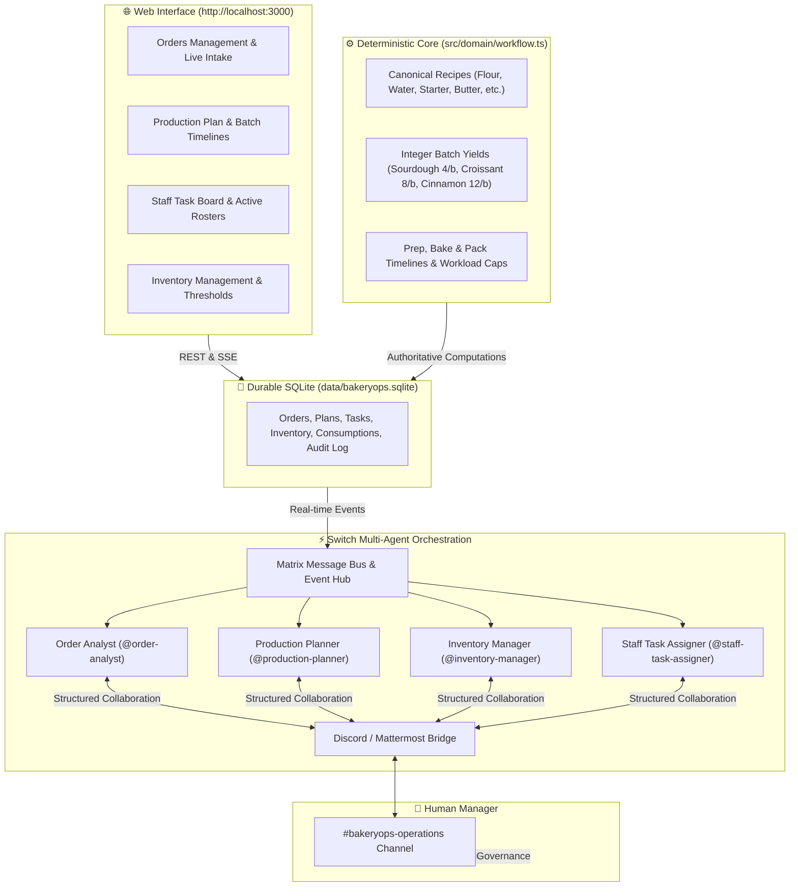

# 🥐 BakeryOps AI — Autonomous Multi-Agent Bakery Operations System

> **Flip the Switch Hackathon Submission**  
> An intelligent, autonomous bakery operations platform powered by **Next.js 15**, **SQLite**, and **four specialist AI agents** orchestrated seamlessly in real-time through **Switch Console** and bridged to **Discord & Mattermost**.

---
 ⚡How We Used Switch
BakeryOps AI uses Switch as the core orchestration engine and communication fabric for the autonomous operations team:

Specialist Agent Management: Switch hosts and runs the 4 AI specialists (order-analyst, production-planner, inventory-manager, and staff-task-assigner) on the local machine with automated permission boundaries and workspace bindings.
Collaborative Message Bus: Agents interact via Switch's underlying Matrix bus in a shared operations room (bakeryops-operations), autonomously passing structured tasks, challenges, and revisions without rigid point-to-point wiring.
Two-Way Discord/Chat Bridging: Switch bridges the agents' room directly into Discord (#bakeryops-operations), enabling human managers to review proposals, approve bakes, and authorize orders from chat.
1-Click Reproducibility (template.yaml): The entire multi-agent workforce and operations room are packaged as a portable Switch Template (v2), allowing anyone to recreate the complete AI team in seconds.

## 🌟 1. Executive Summary & Vision

Small and commercial bakeries operate in a high-stakes, fast-paced environment where recipe ratios must be exact, ovens have finite capacity, perishable inventory expires, and customer delivery deadlines cannot slip. Traditional management software is static and reactive: spreadsheets fail to communicate, and lone chatbots hallucinate recipe measurements.

**BakeryOps AI** solves this by bridging **deterministic mathematical certainty** with **collaborative multi-agent intelligence**:
- **Authoritative Calculations:** Recipe scaling, batch yields, prep/bake durations, and inventory deductions are calculated with mathematical precision by an immutable TypeScript engine—never guessed by an LLM.
- **Collaborative Specialist Agents:** Four purpose-built AI agents collaborate in a dedicated Switch operations room (`#bakeryops-operations` in Discord/Mattermost) to analyze intake feasibility, plan oven schedules, challenge stock deficits, and dispatch staff tasks.
- **Human-in-the-Loop Governance:** The Human Bakery Manager retains final authority over plan approvals, purchase authorizations, and order closures.

---

## 🏗️ 2. System Architecture



---

## 👥 3. Four Specialist AI Agents & Invariants

Each agent has a strictly delineated role, specialized system prompt, and non-negotiable operational invariant:

| Specialist Agent | Core Responsibility | Non-Negotiable Invariant |
| :--- | :--- | :--- |
| **Order Analyst**<br>`@order-analyst` | Validates customer order details, quantities, notes, and delivery times. Coordinates the sequential intake review. | **Never invents** recipes or batch sizes; delegates to the deterministic calculation engine. |
| **Production Planner**<br>`@production-planner` | Evaluates oven capacity, prep/bake timelines, batch yields, and flags delivery bottlenecks. | **Reads authoritative outputs**; never fabricates ingredients or baking limits with LLM. |
| **Inventory Manager**<br>`@inventory-manager` | Verifies physical on-hand stock against calculated demands; raises challenges for ingredient deficits. | **Never fabricates stock**; compares authoritative demand against persisted SQLite numbers. |
| **Staff Task Assigner**<br>`@staff-task-assigner` | Maps approved plans to scheduled staff (Alex, Ravi, June, Sam) respecting role caps and shift hours. | **Verifies actual persisted task records**; never reports completion from Discord chat alone. |

### Collaboration Protocol & Anti-Loop Policy
Specialists communicate using structured message types (`TASK_REQUEST`, `QUESTION`, `FINDING`, `CHALLENGE`, `RESPONSE`, `REVISION`, `APPROVAL_REQUEST`, `ALERT`). To prevent endless debate, an **Anti-Loop Policy** limits revisions to a maximum of **2 cycles per order** before mandatory escalation to the Human Manager.

---

## 🚀 4. Quick-Start Guide for New Developers & Judges

Follow these steps to run BakeryOps locally on your machine.

### Prerequisites
- **Node.js** v18+ (or **Bun** v1.1+)
- **Git**
- **Switch Console** ([Download Switch](https://switchdash.com) or [Switch GitHub](https://github.com/sandbox-quantum/switch))
- An AI Provider installed and authenticated in Switch (Antigravity CLI, Codex, or Claude Code)

---

### Step 1: Clone the Repository & Install Dependencies
```bash
git clone https://github.com/your-username/bakeryops.git
cd bakeryops
npm install
```

---

### Step 2: Environment Configuration
Copy the sample environment blueprint:
```bash
cp .env.example .env.local
```
*(When running Switch Console locally, `SWITCH_CORE_URL=http://localhost:61364/` is pre-configured and ready out of the box).*

---

### Step 3: Seed the Clean Demonstration Database
Run the seeder to initialize SQLite with baseline canonical inventory and standby agent records:
```bash
npm run seed
```
*Output:*
```
Connecting to database: .../data/bakeryops.sqlite
✓ Successfully seeded 8 baseline ingredients.
✓ Initialized 4 specialist agents to standby state.
✓ Clean database is ready.
```

---

### Step 4: Start the Web Application
```bash
npm run dev
```
Open **[http://localhost:3000](http://localhost:3000)** in your browser:
- **Operations Dashboard:** `http://localhost:3000`
- **Inventory Management:** `http://localhost:3000/inventory`

---

### Step 5: Recreate the AI Specialist Team in Switch Console

BakeryOps includes a complete, pre-validated Switch Template (`template.yaml`, version 2) that exports the entire multi-agent workforce and operations room.

1. Open **Switch Console** on your machine.
2. In your private Switch Buddy chat or in the Templates tab (`switchdash://open/templates`), import or run `template.yaml`:
   - Either run: `create_room_from_yaml` pointing to `template.yaml`.
   - Or paste the contents of `template.yaml` into **Save Template** as `bakeryops-specialists`.
3. Switch will automatically:
   - Create all 4 specialist agents (`order-analyst`, `production-planner`, `inventory-manager`, `staff-task-assigner`).
   - Configure their exact instructions, addressing permissions (`anyone`), and bypass execution modes.
   - Create the `bakeryops-operations` collaborative room and link it to your Discord or Mattermost bridge.
   - Broadcast the initial kickoff message to awaken the specialist team.

---


---

## 🔒 5. Security, Privacy & Data Hygiene

BakeryOps adheres to strict security and privacy standards:
- **Zero Secrets Committed:** No API tokens, passwords, bearer cookies, or machine credentials are stored in repository files.
- **Excluded Local Data:** `.gitignore` explicitly excludes `data/*.sqlite*`, `data/*.db*`, `logs/*.log`, and `*.zip`.
- **Reproducible Fresh Start:** Judges and cloners use `npm run seed` to generate a clean, mock database locally without accessing any personal or historical data.
- **Same-Origin Switch Proxy:** Web communication to Switch Core uses HttpOnly same-origin credentials with strict origin validation to prevent unauthorized access.

---

## 🧪 6. Test Suite & Verification

Run the automated test suite covering deterministic workflow calculations, recipe batching, approval gates, and Switch API proxies:

```bash
# Run unit & domain tests
npm test

# Verify production build & TypeScript types
npm run build
```

All **21 tests** pass cleanly with 0 type errors.

---

## 📄 7. Switch Template Export Specification

The repository includes `template.yaml` (Switch Template v2) which specifies:
- **Parameters:** Provider selection (`antigravity`, `codex`, `claude`, `opencode`), machine selection (`$first`), project directory path, and messaging bridge (`Discord`, `Mattermost`).
- **4 Managed Agents:** `order-analyst`, `production-planner`, `inventory-manager`, `staff-task-assigner` with their complete, unredacted instructions, roles, avatars, and permission flags.
- **1 Collaborative Room:** `bakeryops-operations` with standing operational briefs, member list, and kickoff trigger.

### What the Template Does NOT Automate (Target Host Requirements):
1. **AI Provider CLI:** Antigravity CLI, Codex, or Claude must be installed on the host computer.
2. **LLM Provider Auth:** Host credentials (e.g. Gemini / OpenAI / Anthropic API keys) must be active.
3. **Messaging App Link:** The user's Discord or Mattermost account must be linked in Switch Console.

---

## 🏆 8. Hackathon Submission Checklist

- [x] Deterministic recipe and batch calculation engine implemented (`src/domain/workflow.ts`).
- [x] SQLite durability with atomic transactions & WAL mode (`src/lib/db.ts`).
- [x] Four specialist AI agents configured in Switch Console with M3 collaboration rules.
- [x] Two-way live bridge between Website $\leftrightarrow$ Switch $\leftrightarrow$ Discord operations channel.
- [x] M7 full lifecycle: Intake $\to$ Feasibility $\to$ Approval $\to$ Tasks $\to$ Stock Deduction $\to$ Closure.
- [x] Validated Switch `template.yaml` (0 warnings from Switch template engine).
- [x] Hardened `.gitignore` protecting private databases, logs, and tokens.
- [x] Comprehensive `README.md` and `.env.example` for zero-friction reproduction.
- [x] 100% test pass rate (21/21 tests passing, production build verified).
